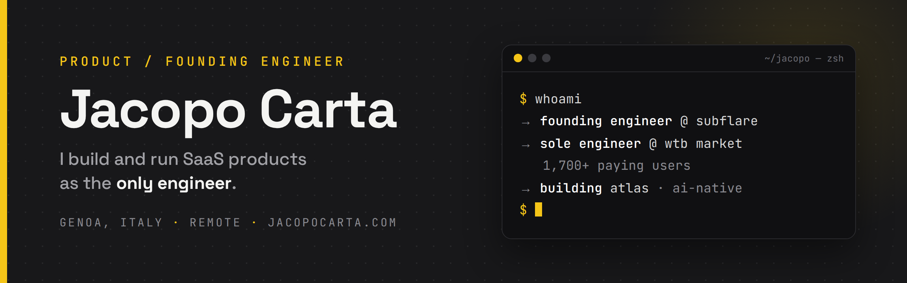

<h3 align="center">
   「  Tech Stack  」 
</h3>

  
  
  
  
  
  
  
  
  

<h3 align="center">
   「  What I'm working on  」 
</h3>

<li>
   🚀 Founding Engineer at <em><a href="https://subflare.ai"> Subflare </a></em> - B2B intent scoring, event-driven AWS infra, IaC with CDK
</li>
<li>
   🔭 Sole engineer behind <em><a href="https://www.wtbmarketlist.eu/"> WTB Market </a></em> - 1,700+ paying users across Europe
</li>
<li>
   🧠 Building <em><a href="https://atlas.jacopocarta.com"> Atlas </a></em> . AI-native personal finance app with MCP server &amp; Apple Pay automations
</li>
<li>
   👨‍💻 My personal portfolio: <em><a href="https://jacopocarta.com"> jacopocarta.com </a></em>
</li>
<li>
   💬 You can reach me via email at <em><a href="mailto:jacopo.cartabmb@gmail.com"> jacopo.cartabmb@gmail.com</a></em> or via <em><a href="https://discord.com/users/610940040536915978"> discord </a></em>
</li>
